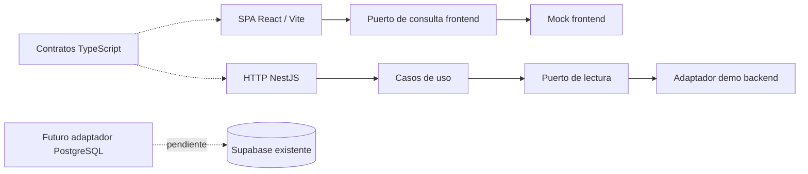

# Arquitectura base

Estado: implementada localmente, con datos sintéticos. Alcance aprobado por el usuario
el 28/10/2026: monolito modular, reorganización del proyecto y opción visual A.

## Vista general



La interfaz y la API demo son ejecutables independientes en desarrollo. La SPA todavía
no consume la API. El contrato compartido permite preparar esa integración sin acoplar
la vista al esquema de persistencia. La integración real y el alojamiento de producción
son decisiones posteriores.

El backend es **una aplicación y un proceso**. Sus nueve límites de dominio no tienen
servidores, colas, despliegues ni bases de datos independientes. PostgreSQL conservará
el esquema académico compartido; la propiedad de tablas es una regla del código.

## Capas de cada módulo

```text
inventory/
├── domain/           Reglas puras: cantidades, fechas y estados
├── application/      Casos de uso y puertos requeridos
├── infrastructure/   Adaptadores que implementan los puertos
├── presentation/     Entrada HTTP o vistas y loaders
├── inventory.module.ts  Composición NestJS, solo en backend
└── public.ts         Integración explícita con otros módulos
```

- Dominio no importa React, NestJS, drivers, HTTP o infraestructura.
- Aplicación depende de dominio y puertos, no de adaptadores ni controladores.
- Infraestructura implementa puertos. Presentación valida entradas y llama a aplicación.
- La composición elige adaptadores. Cambiar demo por persistencia no requiere reescribir vistas.
- `platform/` contiene asuntos técnicos del backend, no reglas comerciales.
- `shared/` contiene UI y utilidades reutilizables del frontend; no importa módulos o `app/`.

Los módulos pendientes tienen registro NestJS y README con su responsabilidad.
Las capas se crean cuando existe un caso de uso: no hay CRUD o clases vacías que simulen
una implementación terminada.

## Integración entre módulos

Cada módulo tiene `public.ts`. Fuera de él, no se importan sus repositorios, fixtures
o controladores. `InventoryQueries` es la API interna actual de Inventario. Los futuros
consumidores usarán consultas públicas o puertos específicos, nunca acceso directo a
clases internas. Evitar dependencias circulares y resolver orquestación en aplicación.

En frontend, `public.ts` expone la integración de Inventario con el shell y el router.
`demo.ts` se usa exclusivamente en composición; `detail.ts` mantiene el detalle como
importación diferida. Los loaders reciben el repositorio por fábrica y no importan `app/`.
No se alteraron las props de Drawer, Tabs, Button, StatusBadge o AsyncState.

`packages/contracts` contiene únicamente contratos y proyecciones públicas de lectura,
sin framework, secretos, SDK de Supabase ni filas de usuario. Cada workspace lo declara
como dependencia local. No importar código fuente del backend desde la SPA.

La comprobación `npm run test:architecture` analiza imports y exports estáticos y
dinámicos con TypeScript, verifica dirección de dependencias y busca ciclos entre módulos.
Es una protección de estructura, no un sustituto de revisión de negocio ni un análisis
de toda posible dependencia construida dinámicamente.

## Datos y transacciones futuras

Se conserva la clave de stock `(id_farmacia, codigo_producto)`, un lote opcional por fila,
la diferencia entre cero, nulo y ausencia, y `DATE` como cadena de fecha sin hora.
No se calcula stock mínimo ni se interpreta vencimiento como bloqueo automático de venta.

No hay conexión de BD, ORM, driver, migraciones o generación automática de esquema.
Al aprobar PostgreSQL, un adaptador por módulo deberá usar consultas parametrizadas,
campos mínimos y paginación en servidor. El adaptador demo en memoria es un ejemplo
de integración y no una estrategia para cargar todo el inventario real.

Una futura venta coordinará sus cambios en una transacción del backend y una misma
conexión. Se deben definir actor, permisos, concurrencia, identificadores e idempotencia
antes de escribir. No se crea ahora una función SQL ni una política de autorización.

Los importes `number` de las proyecciones actuales sirven al piloto sintético. Antes de
operaciones monetarias reales debe aprobarse la representación exacta de `numeric`,
su redondeo y serialización; no se propone calcular ventas con coma flotante.

## Límites de ejecución

La API escucha en loopback, no lee `.env` y declara `mode: demo`, `database: disconnected`.
El frontend no contiene credenciales ni usa la Data API. No se configura CORS ni se
presentan roles de los scripts de llenado como permisos de aplicación aprobados.
