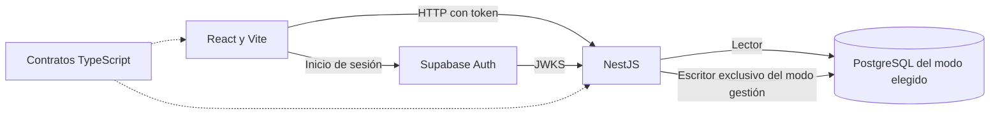

# Arquitectura de VitaFarma

La base adoptada el 28/10/2026 es un monolito modular en NestJS y TypeScript, con una aplicación React/Vite y un paquete de contratos compartidos. El prototipo inicial utilizaba fixtures independientes en frontend y backend. La composición vigente conecta la web con NestJS y consulta los datos persistidos de PostgreSQL. [Decisiones de la base](DECISIONS.md)

## Componentes y entornos

Vite reenvía `/api/v1` a la API local. Las claves públicas del emisor permiten a NestJS comprobar tokens. El mapa privado de identidades asigna perfil y sucursales. El servidor valida ese alcance para los datos solicitados, con independencia de los controles visibles en la interfaz. Las rutas públicas de salud distinguen proceso disponible de conexión lectora válida. [Guía de API](../../backend/README.md)

El entorno de consulta utiliza `vitafarma_practica`. El modo del Trabajo 4 utiliza `vitafarma_gestion` para sus dos conexiones, separadas por rol. Ambos comparten la instancia PostgreSQL de desarrollo y el proveedor Auth local. El monolito se ejecuta en un solo proceso. [Servicios y cuentas](ENTORNO-LOCAL.md)

## Dependencias y módulos

Inventario organiza sus reglas de cantidades y fechas en `domain/`, sus consultas y puertos en `application/`, el adaptador PostgreSQL en `infrastructure/` y los controladores o vistas en `presentation/`. La composición elige el adaptador. Dominio y aplicación permanecen independientes de React, NestJS y los drivers. La infraestructura transversal de lectura y HTTP se encuentra en `backend/src/platform/`. La interfaz reutiliza estilos y controles desde `frontend/src/shared/`.

En backend, `reports` usa la interfaz pública de `inventory` para calcular indicadores con la misma sucursal, filtros y fecha civil. `access` registra el guard y la comprobación de identidad. `sales` registra la API acotada de la práctica. Los nueve módulos conservan su propiedad lógica sobre las 27 tablas del modelo. [Módulos y tablas](MODULES.md)

En frontend, `app/repositories.ts` compone el repositorio HTTP de inventario. React Router mantiene los filtros en la URL y carga el detalle cuando se necesita. Las rutas de gestión comprueban la disponibilidad del servicio para el responsable. Los fixtures se conservan para pruebas aisladas. Las pantallas conectadas muestran el error si falla la consulta.

Los consumidores externos a un módulo usan sus entradas públicas. `packages/contracts` contiene los tipos de lectura, identidad y reportes. Las pruebas de arquitectura verifican imports y ciclos entre módulos. [Flujo de desarrollo](DEVELOPMENT.md)

## Lectura, dinero y transacciones

La dupla farmacia/producto identifica el stock. Un producto sin registro, una cantidad nula y cero unidades siguen siendo casos distintos. El lote asociado puede faltar. Las fechas de negocio se representan como fechas civiles. El adaptador PostgreSQL aplica filtros, totales, orden estable y paginación en el servidor con consultas parametrizadas y transacciones de solo lectura.

En la práctica de gestión, una venta conserva el precio histórico, calcula los centavos en el servidor y confirma la cabecera, los detalles y el descuento de inventario en una transacción. Se bloquean las filas de stock y el identificador de operación controla reintentos. La escritura requiere destinos y roles locales específicos y el perfil autorizado. La ficha académica de usuario y la identidad de Supabase Auth cumplen funciones independientes. [Reglas y contrato de gestión](../../backend/src/modules/sales/README.md)

La conexión del lector al proyecto académico remoto sigue pendiente de credencial mínima verificada y conexión TLS. El arranque de práctica comprueba la huella del snapshot y extrae tablas, restricciones e índices para las copias locales. El proceso conserva el modelo y los triggers del proyecto académico. [Diagnóstico de la base](../DB-CONTEXT.md)
