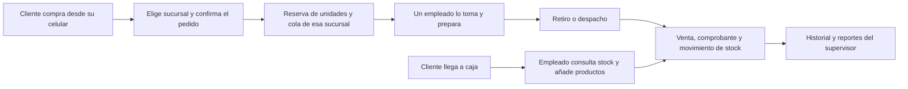

# VitaFarma · Modelo de negocio y plan de compra digital y caja

**Modelo de partida y decisiones aprobadas.** VitaFarma ofrece dos formas de comprar en la misma red de farmacias. El cliente elige productos y completa su pedido desde el celular. La compra presencial se registra en caja. Ambos canales usan el inventario de la sucursal que entrega el producto.

La aprobación posterior fijó el pago online simulado en un paso para las dos modalidades, el supervisor único por departamento y la delegación de empleados a jefes de sucursal. El supervisor aprueba a los jefes de su departamento y cada jefe resuelve las solicitudes de empleado de su sucursal. La referencia de IS corresponde a la portada y sus accesos. Estas decisiones sustituyen las opciones preliminares de cobro y aprobación descritas más abajo. [Guía del piloto local](COMERCIO-LOCAL.md)

## 1. Modelo de negocio

| Elemento | Propuesta |
|---|---|
| Clientes | Personas que quieren consultar disponibilidad antes de salir, comprar para recoger o solicitar envío. Se conserva la atención presencial para quien la prefiera. |
| Valor para el cliente | Elegir sucursal y modalidad, conocer el costo total antes de confirmar y seguir el pedido desde su cuenta. Para recogida, puede esperar el aviso de que está listo antes de ir a la farmacia. |
| Valor para la farmacia | Consultar y vender con un inventario común por sucursal, preparar pedidos en orden y comparar resultados por canal, sucursal y periodo. |
| Canales | Tienda digital para clientes, caja presencial para empleados y panel interno para supervisores. |
| Ingresos | Venta de productos. En el canal de envío, el cargo de entrega se muestra por separado si la farmacia decide cobrarlo. |
| Costes y operación | Stock, tiempo de preparación y atención en caja, entrega, infraestructura y comisiones si se habilita una pasarela de pago. |
| Indicadores | Ventas finalizadas en Bs y unidades por sucursal y canal, tiempo hasta tener el pedido listo, pedidos cancelados por falta de stock y diferencias entre stock físico y registrado. |

El objetivo operativo es evitar esperas innecesarias. La compra digital se registra en autoservicio. La sucursal recibe una orden de preparación y el cliente se presenta al recoger solo cuando corresponda. Para saber si el cambio ayuda, hay que medir el tiempo de preparación y las esperas en caja durante un piloto.

## 2. Quién entra y qué puede hacer

En la portada habrá dos accesos visibles. Ambos pueden usar el mismo Supabase Auth. Los permisos se asignan y validan en el servidor.

| Acceso y perfil | Cómo obtiene acceso | Pantallas y permisos |
|---|---|---|
| **Tienda · Visitante** | Puede entrar sin cuenta. | Elige una sucursal habilitada, busca productos y ve precio y disponibilidad para esa sucursal. Para guardar el carrito o comprar, inicia sesión o crea una cuenta. Al volver, recupera la sucursal y el producto que había elegido. |
| **Tienda · Cliente** | Se registra desde la tienda. | Guarda el carrito, elige retiro o envío según disponibilidad y consulta sus propios pedidos y comprobantes. Puede cambiar de sucursal antes de confirmar. El sistema vuelve a verificar el carrito porque cambian stock, precio o modalidad. |
| **Personal · Empleado** | El supervisor invita y asigna una cuenta individual a las sucursales autorizadas. | Consulta inventario, registra ventas en caja y toma pedidos de la sucursal activa. Accede a los datos del cliente necesarios para la venta o entrega correspondiente. |
| **Personal · Supervisor** | Se conserva el alta administrativa actual y la asignación explícita de sucursales. | Invita y desactiva accesos de empleados de sus sucursales, consulta personal, gestiona catálogo y movimientos de stock según alcance y revisa historial y reportes. La acción de vender corresponde al empleado. El supervisor puede auditar y reasignar pedidos si alguien no puede continuar. |

**Supervisor por departamento.** La configuración actual asigna una o varias sucursales por identidad. La propuesta permite que un supervisor cubra las sucursales autorizadas de un departamento o solo un subconjunto. Que exista exactamente un supervisor por departamento es una decisión del equipo. La farmacia elegida por un cliente define qué sucursal vende y prepara su compra. El cliente puede elegir otra sucursal habilitada aunque se encuentre físicamente en otro lugar.

**Identificación en caja.** La cuenta del cliente en la tienda y su ficha comercial cumplen funciones distintas. En caja, el empleado puede buscar o registrar una ficha cuando la operación lo requiera. La propuesta deja el CI como dato sujeto a la política de comprobantes que el equipo confirme. La tienda pública y la bandeja general excluyen ese dato.

## 3. Cómo se realiza cada compra

### Compra online

1. El cliente abre la tienda, elige una sucursal, añade cantidades e inicia sesión al guardar o comprar. Cada pedido pertenece a una sola sucursal.
2. Selecciona **retiro** o **envío**, cuando el servicio esté habilitado. Antes de confirmar ve precio, disponibilidad y, para envío, cobertura y coste.
3. El servidor comprueba que todas las líneas estén disponibles, guarda cantidades y precios, reserva las unidades y devuelve el número de pedido. La persona compra en autoservicio y recibe el estado de su pedido sin tener que esperar a un empleado.
4. Los empleados habilitados de esa sucursal ven el pedido en la bandeja. El que lo toma pasa a ser el responsable de prepararlo. El cliente ve cuándo está listo para retirar o cuándo se despachó.
5. La primera versión cobra **al retirar**. La versión con delivery puede cobrar contra entrega. Un pago en línea integrado se planifica como siguiente incremento y exige definir cuándo se confirma, cómo se libera una reserva si falla y cómo se reconcilia con la venta. En un envío contra entrega, el stock sale al despachar y el cobro se registra por separado al entregar.

### Venta presencial

1. El empleado abre **Caja** en una sucursal asignada. Busca los productos y agrega sus cantidades. Vincula la ficha del cliente si corresponde.
2. Al confirmar el cobro, la aplicación valida cantidades y precios, registra la venta y sus líneas, ajusta stock y genera un comprobante interno.
3. La venta aparece en el historial de supervisión con sucursal, fecha, canal, empleado y totales. El comprobante fiscal, si el equipo lo exige, se planifica como integración separada.

**Un retiro de compra online se finaliza desde el pedido existente.** Si el cliente presenta su código en caja, el empleado busca ese pedido y completa su entrega. Así queda una sola venta y se consumen las unidades de la reserva original.

## 4. Cómo se ordenan los pedidos y cómo se actualiza el stock

| Situación | Regla propuesta |
|---|---|
| Varios empleados ven el aviso | La bandeja muestra los pedidos de su sucursal en orden de confirmación. El más antiguo disponible es el primero sugerido. Mostrar hora, modalidad y estado permite ordenar el trabajo en horas de alta demanda. |
| Dos empleados pulsan **Tomar pedido** | El servidor cambia el estado a **En preparación** y asigna el responsable en una sola operación de base de datos. La primera operación confirmada gana. El segundo empleado ve «Este pedido ya lo está preparando otro empleado» y su bandeja se actualiza. |
| El responsable abandona el pedido | Puede devolverlo a la cola indicando un motivo. El supervisor puede reasignarlo dentro de la misma sucursal. Ambas acciones quedan registradas. |
| Dos clientes compran la última unidad, o se cruza una compra online con caja | Las operaciones usan el mismo stock de la sucursal. La primera transacción válida obtiene la unidad. La siguiente recibe un aviso y puede ajustar el carrito o elegir otra sucursal. Una orden de varias líneas se confirma completa o se devuelve para revisión. |
| El cliente confirma una compra online | Baja el **disponible para vender**, porque equivale al stock físico menos las reservas activas. El cambio aparece en el catálogo y en caja. Si el disponible llega a cero, el producto se muestra como **Agotado** en esa sucursal. |
| Se entrega, se despacha o se cancela | En retiro se descuenta el stock físico al entregar. En envío, al despachar. En ese mismo movimiento se consume la reserva. Una cancelación o vencimiento previos a la salida liberan las unidades. Un retorno posterior al despacho se registra cuando la sucursal comprueba su recepción. |
| Se corta la conexión durante la confirmación | Al reintentar la misma operación, el sistema devuelve el pedido o venta ya registrados. Se conserva un comprobante y un único movimiento por operación. |
| El supervisor carga o corrige stock | Registra sucursal, producto, cantidad, motivo, fecha y autor. La corrección valida reservas activas. Si faltan unidades físicas para cumplir un pedido, el caso pasa a resolución con registro del ajuste. |

Estados visibles al cliente para retiro: **Confirmado → En preparación → Listo para retirar → Entregado**. La variante de envío emplea **En camino** antes de **Entregado**. Ambos flujos contemplan **Cancelado**. La fecha límite de retiro y la política de cancelación se muestran antes de confirmar. Los estados de pago se guardan aparte del estado operativo del pedido.

## 5. Pantallas y referencia de IS

- **Tienda:** selección de sucursal, catálogo, ficha del producto, carrito, confirmación y **Mis pedidos**. La vista 3D puede incorporarse en algunas fichas como complemento al nombre, presentación, precio y disponibilidad.
- **Empleado:** **Caja**, **Inventario** y **Pedidos**. Cada pedido ofrece una acción principal según su estado. El aviso de entrada actualiza la bandeja y se recupera el estado al reconectar.
- **Supervisor:** historial filtrado por fecha, sucursal, canal y estado, resumen de ventas por sucursal, stock y movimientos, personal y accesos. El ranking inicial se ordena por total cobrado en Bs de ventas finalizadas y permite comparar unidades. Cada venta conserva la sucursal donde ocurrió, aunque después el empleado cambie de lugar.

En `IS/umssy-app` hay una bandeja de notificaciones y una cola con filtros. La propuesta para VitaFarma toma de ahí la idea de **mostrar el aviso en pantalla y usar una bandeja filtrable con detalle**. El flujo sirve desde el primer incremento con un aviso dentro de la aplicación. La pantalla exacta de referencia queda por confirmar si se referían a otra vista de IS.

## 6. Plan de implementación después de la aprobación

Estimación orientativa para un desarrollador a 6 h por día, con una revisión por etapa. Las horas incluyen pruebas y se refinan al revisar reglas de compra y el alcance del esquema. La versión académica ya entregada sirve de base. Las pruebas de escritura para esta ampliación empiezan en una copia aislada.

| Etapa | Trabajo | Criterio de aceptación | Esfuerzo |
|---|---|---|---:|
| **1. Identidades y caja** | Mantener el alta de supervisores, agregar invitación y baja de empleados y registro de clientes, aplicar permisos por sucursal y adaptar la venta de práctica a caja. Pasar la acción de venta al empleado. Agregar carga y ajuste de stock auditados. Conservar sucursal, canal y empleado en cada venta nueva. | Un empleado vende solo desde su sucursal. El supervisor asigna permisos, registra movimientos de stock y ve la venta en historial. Un cliente solo accede a sus propios datos. | 20–30 h |
| **2. Tienda con retiro** | Catálogo público por sucursal, inicio y retorno al carrito, confirmación, reservas con vencimiento y Mis pedidos. | El cliente compra por su cuenta. Si compite por la última unidad con otro cliente o con caja, el saldo queda correcto. La cancelación previa a la entrega devuelve disponibilidad. | 26–38 h |
| **3. Preparación e historial** | Bandeja y aviso por sucursal, orden de llegada, toma exclusiva, preparación, retiro con código, comprobante y ranking para supervisores. | Dos empleados pueden abrir la misma cola, pero solo uno se asigna cada pedido. Un retiro deja una sola venta. El reporte coincide con las ventas efectivas por sucursal y canal. | 20–30 h |
| **4. Piloto local** | Ensayar compra online y caja en paralelo, revisión de permisos y visibilidad, abandono de pedidos, expiraciones, reintentos y comparación de saldos e importes. | La sucursal completa el recorrido con dos sesiones de empleado y una de cliente. Se puede rastrear pedido, responsable, venta y movimiento de stock. | 12–18 h |
| **5. Envío y mejoras** | Agregar zonas, tarifas, dirección, despacho, seguimiento y tratamiento de incidencias. Definir posteriormente pago online, comprobante fiscal y productos con vista 3D. | El cliente ve cobertura y coste antes de comprar. La sucursal diferencia despacho, entrega y cobro. Antes de habilitar una pasarela se prueban rechazos y reintentos de pago. | 18–28 h para envío. Pago, 3D y comprobante fiscal se estiman según alcance. |

El primer recorrido de retiro de punta a punta se estima en **78–116 h**, unas **13–20 jornadas**. La arquitectura propuesta reutiliza React, NestJS y PostgreSQL/Supabase. Habrá que revisar con el equipo cómo persistir pedidos y reservas y guardar la sucursal histórica de las ventas. La versión actual infiere la sucursal desde el empleado. Cualquier ampliación se presenta primero para revisión y prueba aislada antes de considerar cambios en Supabase académico.

## 7. Decisiones para aprobar el plan

1. **Cobro.** Empezar con compra online y pago al retirar, luego contra entrega para envíos. Confirmar si el pago en la web es indispensable para la primera versión.
2. **Supervisión.** Mantener asignación por sucursales y permitir que abarque un departamento. Confirmar si el negocio exige un supervisor por departamento o acepta varios con áreas distintas.
3. **Operación.** Acordar cuánto dura la reserva, en qué horario se recoge y quién atiende incidencias de envío. Elegir el dato mínimo de cliente para el comprobante de caja.
4. **Referencia de pantalla.** Confirmar la bandeja y los filtros de UMSSY como referencia funcional de **Pedidos**, o identificar la pantalla concreta de IS que se quiere usar.

Los cuatro bloques funcionales del Trabajo 4 siguen cubiertos por la entrega actual. La tienda digital y la cola de preparación amplían la operación de VitaFarma a partir de esa entrega. [Acta de los tres sprints](CIERRE-RELEASE-2026.md) · [Informe de interfaces](../trabajo-4/README.md)
