# VitaFarma · Interfaces de la cadena de farmacias

Universidad Mayor de San Simón · Facultad de Ciencias y Tecnología · Taller de Base de Datos · Semestre II-2026.

**Trabajo 4, Parte II.** La demostración sigue una farmacia y un empleado nuevos, un producto y su especialización, y una venta que se puede rastrear hasta el saldo de la sucursal. Cada ficha empareja una captura del navegador con los resultados obtenidos al leer directamente PostgreSQL.

[Descargar el informe para impresión](VitaFarma-interfaces.pdf) · [Versión HTML](interfaces.html) · [Consultas de verificación](consultas.sql)

## Entorno y comprobación

La práctica utiliza la copia local vitafarma_gestion en PostgreSQL 17. Las tablas, claves y relaciones provienen de la instantánea del modelo académico. La carga identificable y los registros del informe son ficticios. El backend NestJS valida la sesión de Supabase Auth y el alcance de sucursales en cada petición. Las consultas de evidencia se ejecutaron en sesiones de solo lectura de psql. Revisión del formulario de venta `126a3da`.

Con Docker Desktop activo y las dependencias del repositorio instaladas, ejecutar npm run dev:gestion desde la raíz. Abrir http://127.0.0.1:5173/equipo/entrar para iniciar la práctica. Las cuentas de prueba y los archivos de conexión permanecen en la carpeta privada de la práctica. [Entorno local](../architecture/ENTORNO-LOCAL.md)

Entrar con la cuenta responsable de la práctica, abrir Gestión, buscar un registro por su ID y cotejar la pantalla con la consulta de la ficha. Para enseñar la conservación del saldo, localizar la venta 100060 en el historial y abrir su detalle. En una instalación nueva los identificadores se asignan al crear los ejemplos; se sustituyen en las consultas por los de esa instalación.

## Sucursales

Farmacias y empleados · `/practica/farmacias`

Cada farmacia tiene un identificador y puede vincularse con una ciudad. El responsable busca la sucursal, registra su dirección y puede corregirla desde el mismo formulario. El alta requiere un ID dentro de su alcance.

El registro 3 identifica Farmacia Alameda · Informe T4 y la vincula con Sucre. La referencia de ciudad utiliza su ID para que dos nombres parecidos no introduzcan una relación ambigua.

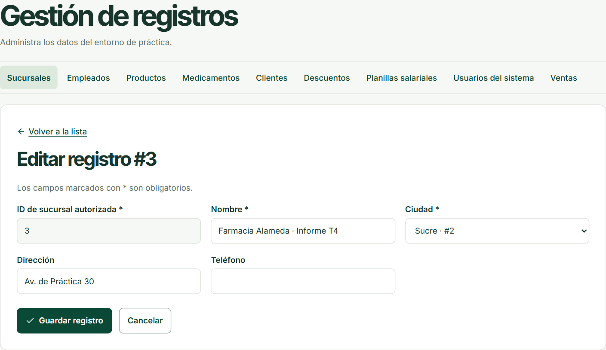

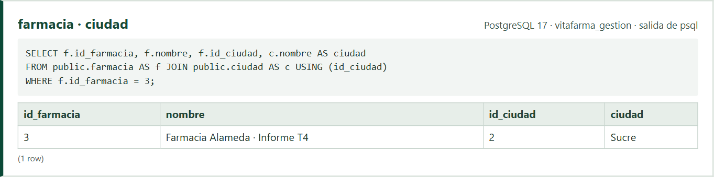

## Empleados

Farmacias y empleados · `/practica/empleados`

El responsable registra al empleado y selecciona su cargo y farmacia. El vínculo con la sucursal determina dónde puede intervenir y qué registros de personal se muestran al supervisor.

El empleado 100011 quedó en la farmacia 3 con el cargo Atención de práctica. Este empleado se reutiliza en las fichas de planilla y usuario.

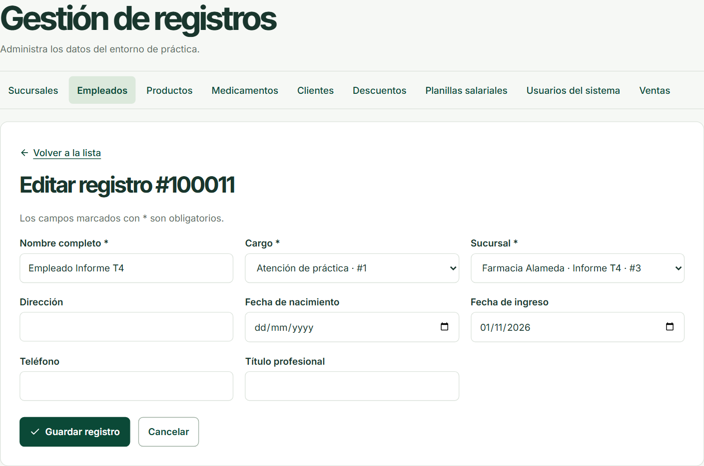

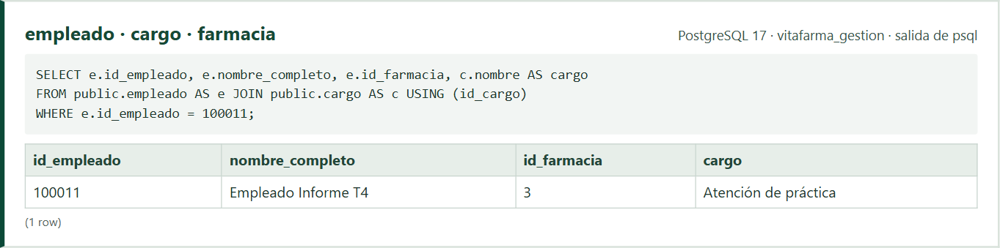

## Productos

Productos e inventario · `/practica/productos`

El catálogo conserva nombre, presentación, categoría y precios. El registro comercial existe con independencia de que una farmacia ya tenga unidades cargadas.

Se registró el producto 100012 con categoría Medicamentos, precio de compra de Bs 4,00 y precio de venta de Bs 7,50. El mismo código identifica después su especialización.

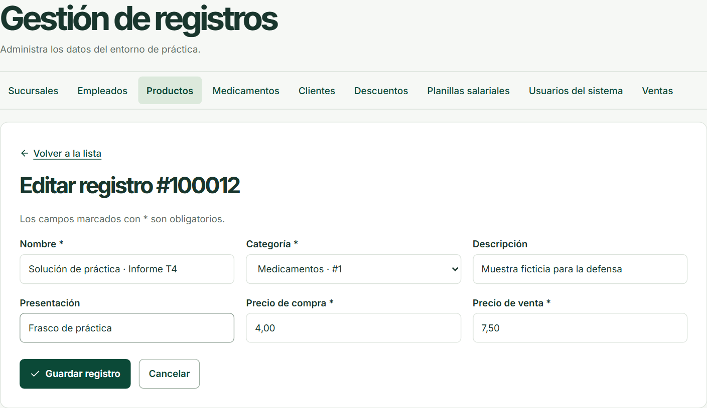

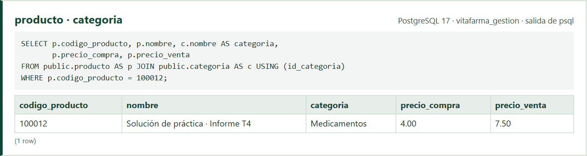

## Medicamentos

Productos e inventario · `/practica/medicamentos`

La ficha especializa un producto ya registrado. El formulario conserva su código y asocia laboratorio, fecha de vencimiento de la ficha y un texto descriptivo.

El código 100012 enlaza la especialización con el producto de la página anterior. El lote que tiene existencias en una farmacia dispone de su propia fecha de vencimiento.

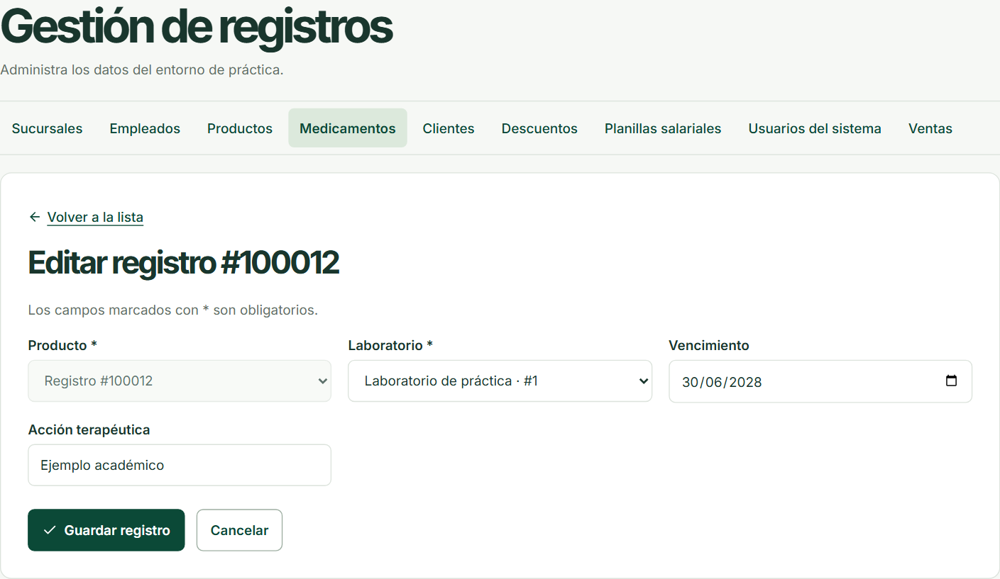

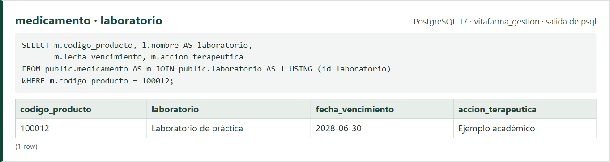

## Existencias por sucursal

Productos e inventario · `/inventario?farmacia=2&q=101`

El operador elige la sucursal y busca por nombre o código. La tabla presenta el saldo asociado al producto en esa farmacia. Un cero, una cantidad sin registrar y un producto sin fila son estados distintos.

La consulta muestra el producto 101 en Sucursal Norte después de la venta del informe. La comparación incluye Centro para demostrar que la cantidad y el lote dependen de farmacia y producto.

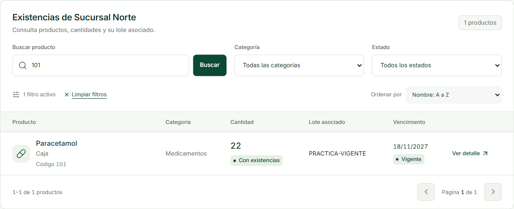

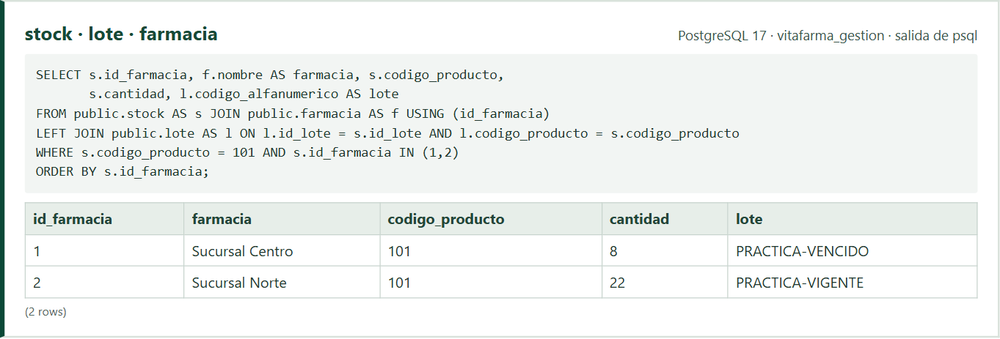

## Selección y registro de una venta

Ventas · `/practica/ventas`

El formulario reúne sucursal, empleado, cliente y líneas. Cada línea exige seleccionar un producto y una cantidad. Antes de confirmar, el responsable puede revisar el importe estimado y quitar líneas.

Se seleccionó una unidad del producto 101 en la farmacia 2 para el cliente 100013. La captura de stock se tomó antes de confirmar el cobro desde esta pantalla.

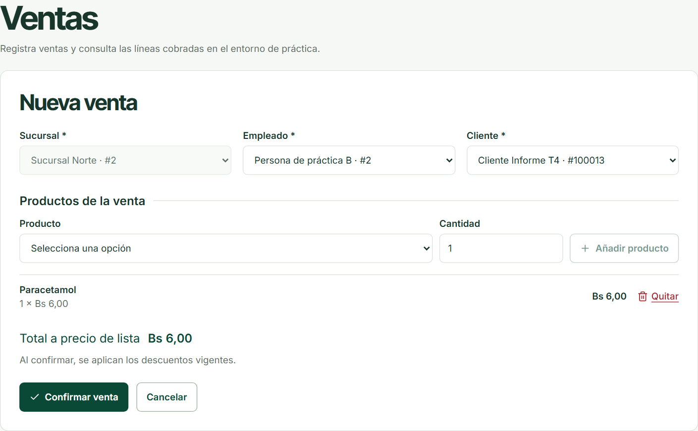

## Detalle y movimiento de existencias

Ventas · `/practica/ventas`

El historial permite abrir el comprobante interno y consultar la fecha, la sucursal, el cliente y las líneas con su precio histórico. El servidor registra la cabecera y las líneas y descuenta la existencia dentro de una transacción.

La venta 100060 cobró Bs 6,00. La misma referencia aparece en venta y detalle_venta. El stock del producto 101 en Norte pasó de 23 a 22 unidades.

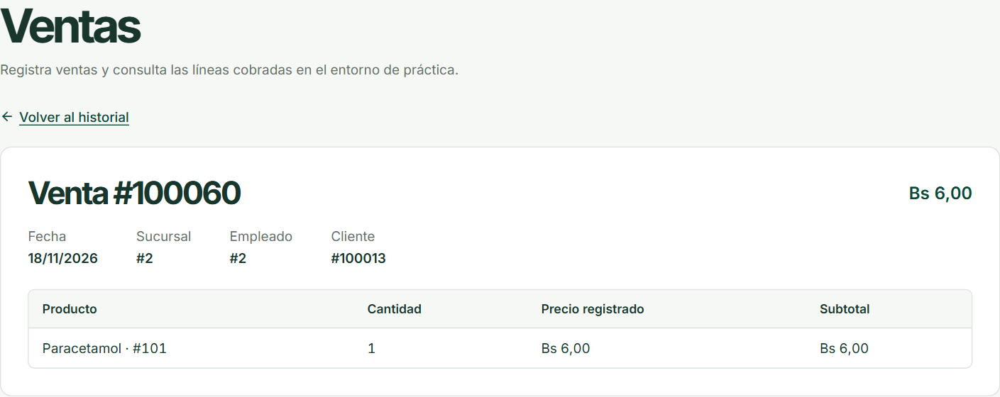

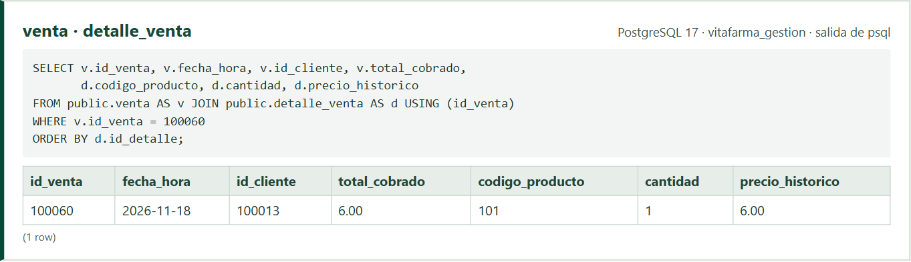

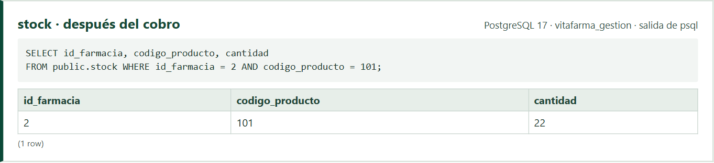

## Clientes

Administración · `/practica/clientes`

La ficha permite registrar y localizar clientes. Los campos de contacto son opcionales en este ejemplo. Para asociar una operación comercial se selecciona el cliente por su ficha.

Se utilizó exclusivamente el cliente ficticio 100013. Su identificador figura también en la cabecera de la venta.

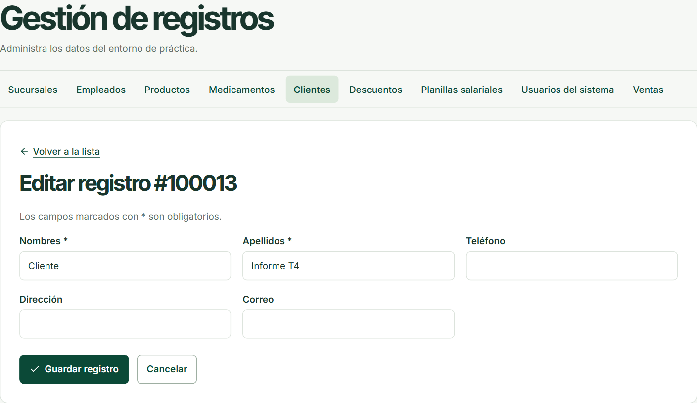

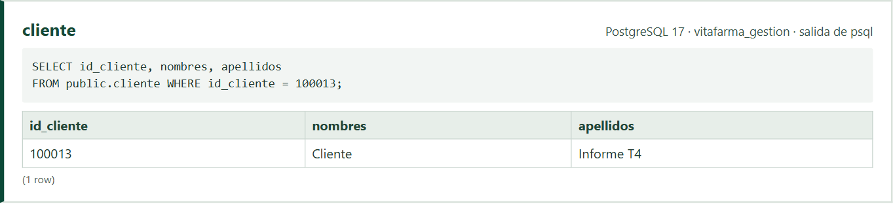

## Descuentos

Administración · `/practica/descuentos`

El descuento se asocia a un producto y a un intervalo de fechas. El porcentaje y las fechas se validan al guardar. La vigencia sirve al cálculo del precio aplicado por el servidor cuando se vende el producto.

La fila 100014 asigna el 10 % al producto 100012 durante noviembre de 2026. La venta ilustrada usa el producto 101.

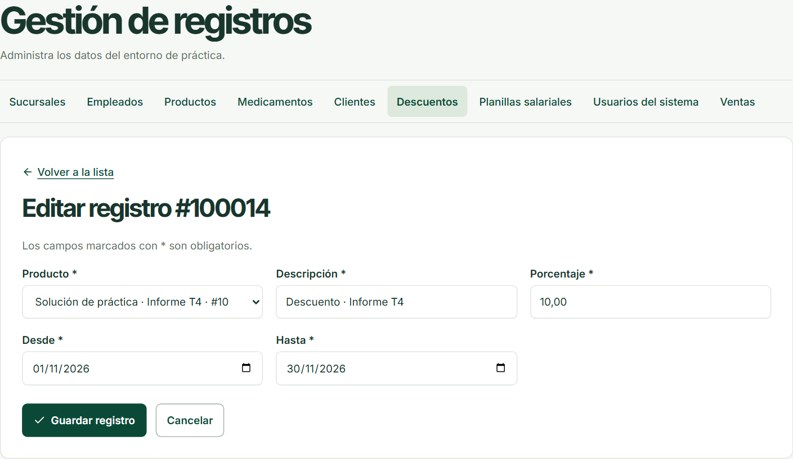

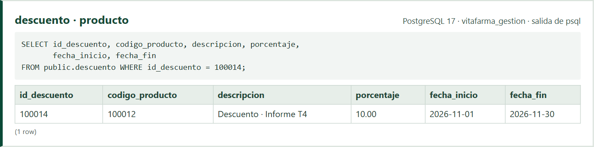

## Planillas salariales

Administración · `/practica/planillas`

El responsable selecciona al empleado y carga sueldo base, antigüedad, bonos y descuentos. El servidor calcula el importe final y lo persiste con la fecha de elaboración.

Se modificaron los bonos de Bs 30,00 a Bs 45,00 y se guardaron desde la interfaz. La base pasó de Bs 540,00 a Bs 555,00 para la planilla 100015 del empleado 100011.

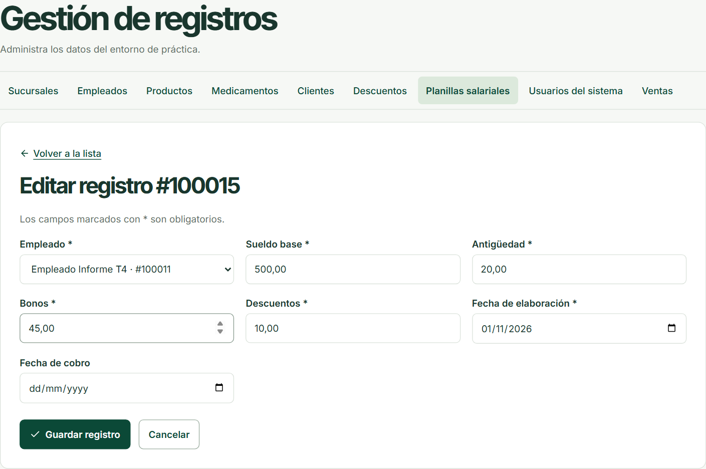

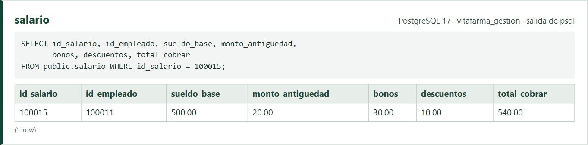

## Usuarios del sistema

Administración · `/practica/usuarios`

La cuenta académica vincula nombre de usuario, empleado, rol y estado. Supabase Auth verifica por separado la sesión del personal que ingresa a VitaFarma.

La cuenta 100016 vincula el empleado 100011 con el rol Consulta y el estado ACTIVO. La consulta de evidencia se limita a esos campos.

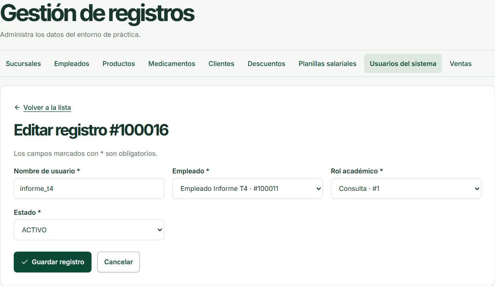

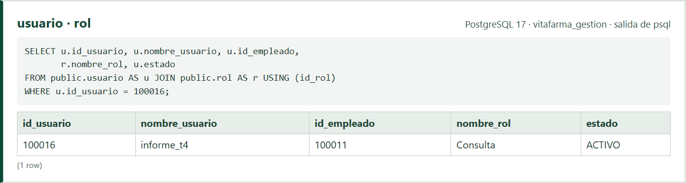
